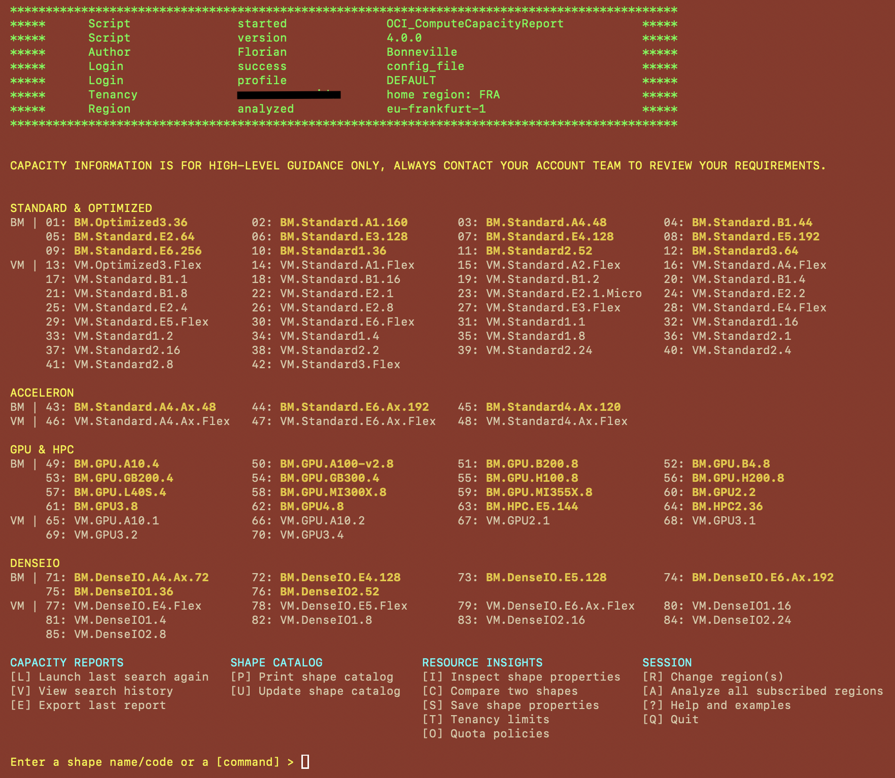
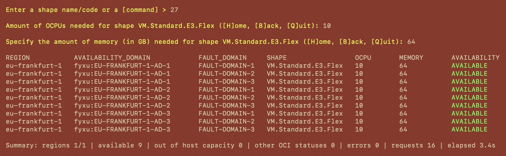
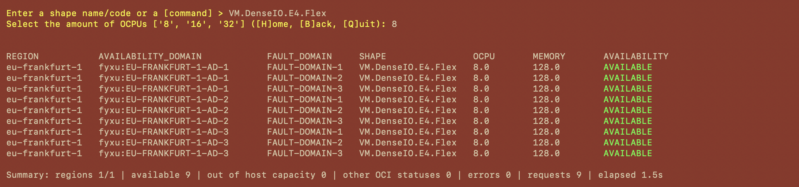
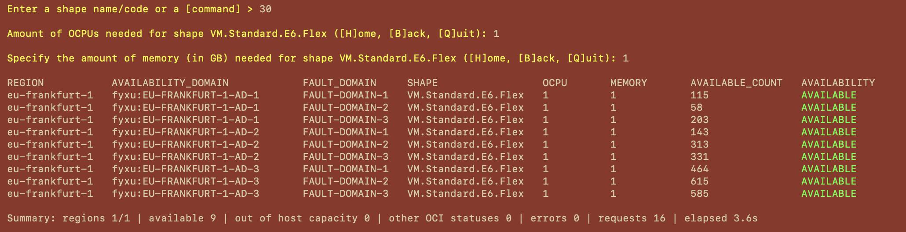
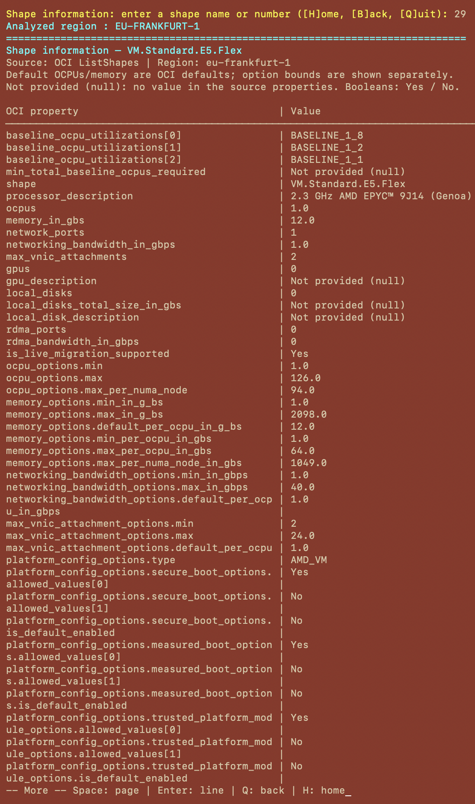
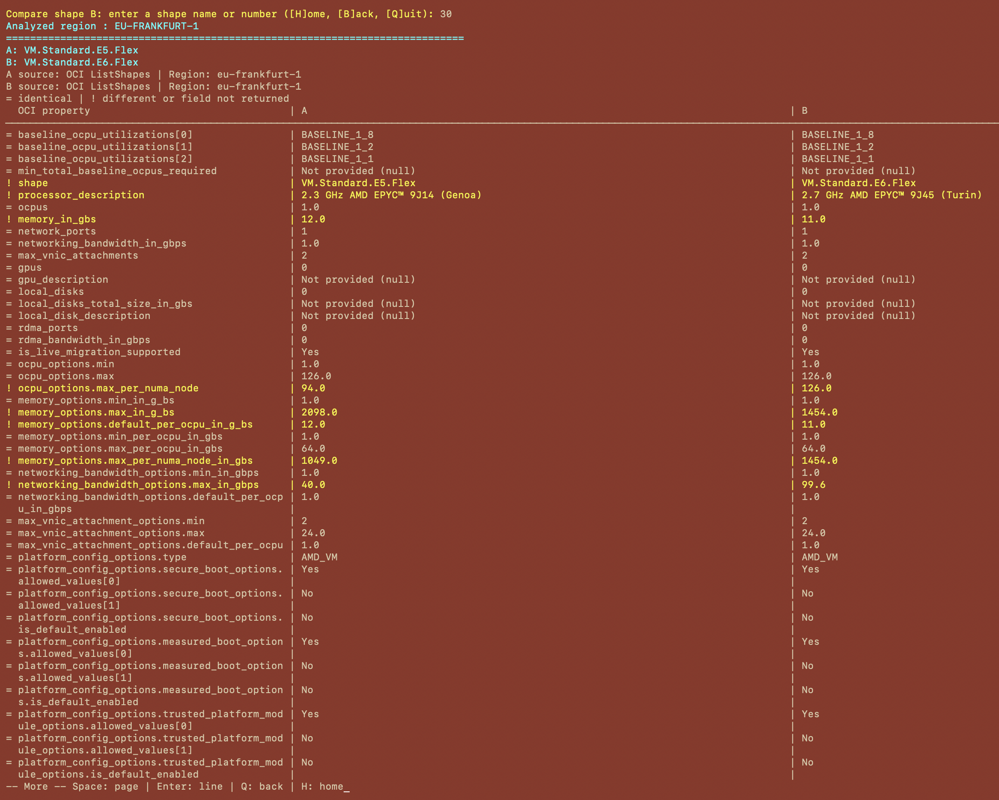
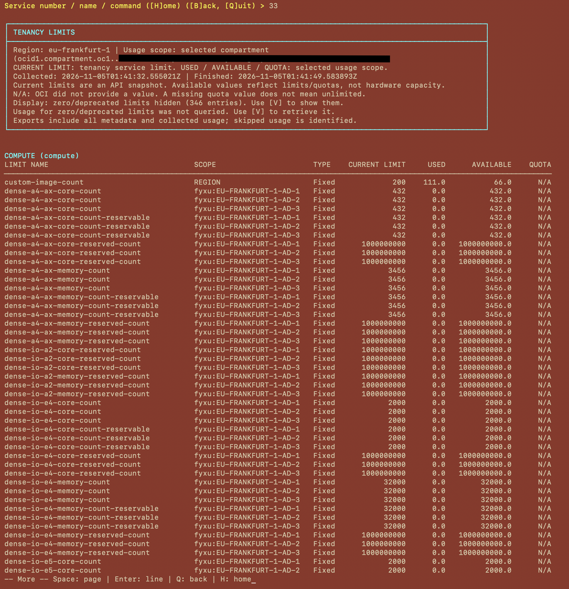
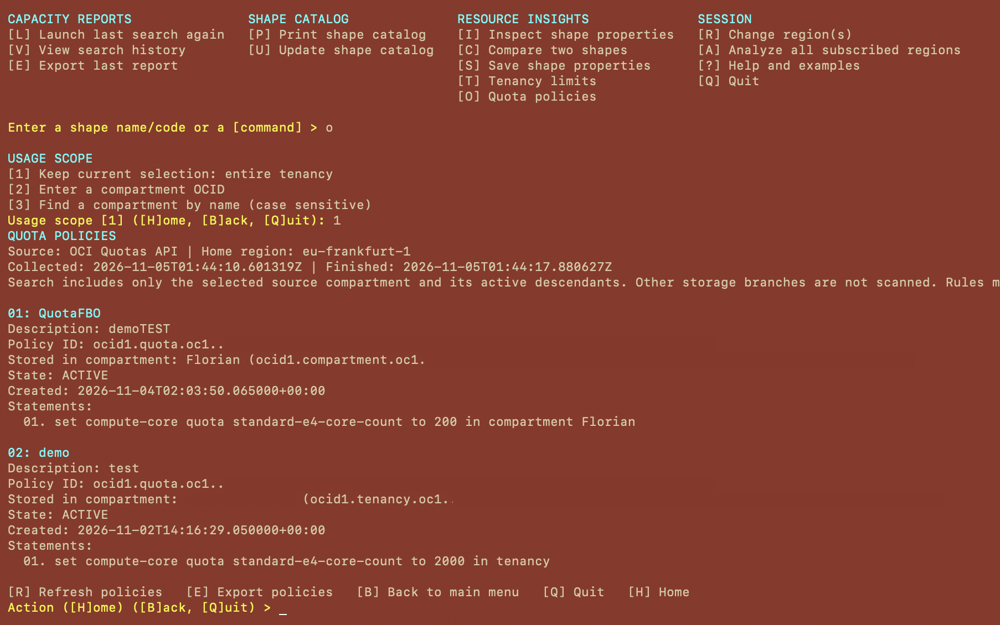
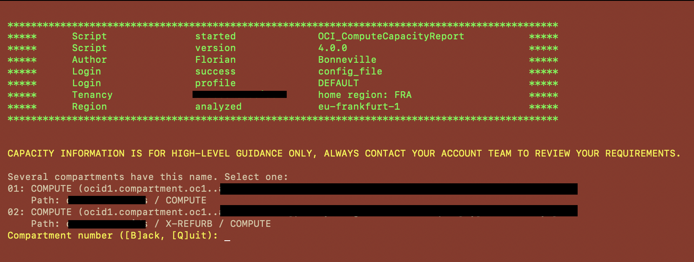

# OCI_ComputeCapacityReport

**Explore OCI Compute capacity, shape properties, service limits, usage and quota policies from one interactive terminal.**

Originally focused on Compute capacity reports, this tool now helps answer several related questions: 

- **Where can I deploy ?**
- **What can a shape provide ?**
- **How much can my tenancy use ?**
- **What is already consumed ?**
- **Which quota policies are configured ?**



| What you want to do | What the script provides | Where to start |
| --- | --- | --- |
| Find Compute capacity | Live shape availability by region, Availability Domain (AD) and Fault Domain (FD) | Enter a shape name or catalog code |
| Discover shapes | A numbered catalog combining predefined shapes and OCI discoveries across the selected regions | **P** / **U** |
| Understand or compare shapes | Complete OCI properties, side-by-side comparison and JSON/TXT property exports | **I** / **C** / **S** |
| Check service limits and usage | Dynamically discovered services, fixed/dynamic limit values, usage, availability and effective quotas where provided | **T** |
| Read quota policies | Active policies stored in a selected compartment and its active descendants, with full statements and JSON/CSV exports | **O** |
| Reuse and share findings | Capacity search history, fresh replays and report exports | **L** / **V** / **E** |

**The script does not provision instances, reserve capacity, change service limits or modify quota policies.**

**It queries OCI, displays results, and writes local files only for requested exports or the shape-reference update.**

**Four different views:** 

- Compute capacity report describes host capacity
- Service limits and resource availability describe tenancy allowances and usage
- Quota policies describe administrator-defined rules.
- Shape properties describe and compare shape features

> Capacity information is for high-level guidance only. Always contact your Account Team to review requirements with the OCI Capacity Planning team. An out-of-capacity result is not a final capacity-planning decision.

## Contents

- [Quick start](#quick-start)
- [Interactive menu](#interactive-menu)
- [Compute capacity reports](#compute-capacity-reports)
- [Shape catalog and discovery](#shape-catalog-and-discovery)
- [Shape properties, comparison and export](#shape-properties-comparison-and-export)
- [Tenancy limits and usage](#tenancy-limits-and-usage)
- [Quota policies](#quota-policies)
- [Regions and compartments](#regions-and-compartments)
- [Reports, exports and session memory](#reports-exports-and-session-memory)
- [Command-line reference](#command-line-reference)
- [Authentication and IAM access](#authentication-and-iam-access)
- [Support and disclaimer](#support-and-disclaimer)

## Quick start

You need Python 3, the OCI Python SDK, and access to the OCI APIs used by your chosen features. You can run the tool locally, in OCI Cloud Shell, or on an OCI instance using instance principals. See [authentication and IAM access](#authentication-and-iam-access).

Example installation in a virtual environment, using a POSIX shell:

```bash
git clone https://github.com/Olygo/OCI_ComputeCapacityReport.git
cd OCI_ComputeCapacityReport
python3 -m venv .venv
source .venv/bin/activate
python3 -m pip install oci
python3 OCI_ComputeCapacityReport.py
```

Start with a specific profile, compartment and region:

```bash
python3 OCI_ComputeCapacityReport.py \
  -auth cf -profile DEFAULT \
  -comp "Production" \
  -region eu-frankfurt-1
```

Without explicit options, the script tries Cloud Shell, config-file and instance-principal authentication in that order, starts with the home region, and asks for the tenancy/compartment selection when needed. It then displays the shape catalog and menu. You can immediately choose **T** for limits or **O** for quota policies, **a capacity search is not required first.**

For command-line help or the complete paginated guide:

```bash
python3 OCI_ComputeCapacityReport.py --help
python3 OCI_ComputeCapacityReport.py --help-full
```

`--help-full` opens before authentication and makes no OCI calls. The OCI SDK must still be installed to import the main script.

## Interactive menu

The home menu groups actions into **CAPACITY REPORTS → SHAPE CATALOG → RESOURCE INSIGHTS → SESSION**:

```text
CAPACITY REPORTS               SHAPE CATALOG              RESOURCE INSIGHTS              SESSION
[L] Launch last search again   [P] Print shape catalog    [I] Inspect shape properties   [R] Change region(s)
[V] View search history        [U] Update shape catalog   [C] Compare two shapes         [A] Analyze all subscribed regions
[E] Export last report                                    [S] Save shape properties      [?] Help and examples
                                                          [T] Tenancy limits             [Q] Quit
                                                          [O] Quota policies

Enter a shape name/code or a [command] >
```

In `all_regions` mode, **M — Move to a single region** replaces the region-selection/all-regions actions shown above. The menu adapts to four, two or one column according to terminal width.

| Group | Action | What happens |
| --- | --- | --- |
| Capacity reports | Shape name or code, such as `VM.Standard.E5.Flex` or `01` | Start a fresh capacity search |
| Capacity reports | **L** | Launch the latest capacity search again in its original context |
| Capacity reports | **V** | View up to 20 recent capacity searches and select one to replay |
| Capacity reports | **E** | Export the last capacity report as JSON or CSV |
| Shape catalog | **P** | Clear the terminal and print the cached catalog |
| Shape catalog | **U** | Discover shapes again and replace the catalog after successful refresh |
| Resource insights | **I** | Inspect the full properties of one shape |
| Resource insights | **C** | Compare two shapes properties |
| Resource insights | **S** | Save shape properties as raw JSON or readable TXT |
| Resource insights | **T** | Browse service limits, usage and effective quotas |
| Resource insights | **O** | Browse and export quota policies |
| Session | **R** | Change to one or several selected regions |
| Session | **A** | Analyze all subscribed regions that pass connectivity validation |
| Session | **M** | Move from all-regions mode to one region |
| Session | **?** | Open help and examples |
| Session | **Q** | Quit |

**Commands are case-insensitive.** Shape codes refer to the last displayed catalog and can change after a successful catalog update or region change. Full shape names remain valid input even if they are absent from the catalog.

In input submenus, **B** goes back, **H** returns Home and **Q** quits. At a pagination prompt, **Q/B** closes the document, it does not quit the program. **Space** advances a page and **Enter** advances one line. Main-menu **H/Home** also redisplays the home catalog.

> **Screenshot to add — `.images/05-home-menu.png`:** capture the current numbered catalog and all four menu groups, including T and O under RESOURCE INSIGHTS.
<!-- Screenshot: once captured, replace the note above with  -->

## Compute capacity reports

Enter a full shape name or its catalog code. For applicable Flex shapes, supply positive integer OCPU and memory values. The script queries OCI and reports results per region, AD and FD.

| Status | Meaning |
| --- | --- |
| `AVAILABLE` | OCI reports capacity available for the requested configuration at query time |
| `OUT_OF_HOST_CAPACITY` | OCI reports insufficient host capacity for that request at query time |
| `HARDWARE_NOT_SUPPORTED` | OCI reports the requested hardware/configuration as unsupported at that location |
| `REQUEST_ERROR` | A local report marker for a failed request, not an OCI capacity status |

A successful query does not reserve resources or guarantee that a later deployment will succeed. Likewise, `OUT_OF_HOST_CAPACITY` does not establish a future replenishment date.



A typical interactive flow is:

```text
VM.Standard.E6.Flex → requested OCPUs → requested memory → capacity report
L                  → fresh repeat of that search
V → history number → fresh replay of an earlier search
E → JSON or CSV    → save the last report
```

### Resource configuration

The script adjusts CPU/memory requests using available metadata and its shape rules. Memory is constrained by the selected CPU count, total memory bounds and memory-per-OCPU ratios. When requested CPUs exceed the maximum, the saturation rule selects the maximum allowed CPUs and their maximum allowed memory.

DenseIO Flex shapes use predefined CPU/RAM/NVMe combinations, filtered against OCI metadata when available:

| Shape | OCPU choices | Associated resources |
| --- | --- | --- |
| `VM.DenseIO.E4.Flex` | 8, 16, 32 | 128/256/512 GB and 1/2/4 NVMe drives |
| `VM.DenseIO.E5.Flex` | 8, 16, 24, 32, 40, 48 | 96–576 GB and 1–6 NVMe drives |
| `VM.DenseIO.E6.Ax.Flex` | 8, 16, 24, 32, 40, 48 | 96–576 GB and 1–6 NVMe drives |



**For DRCC/ALOY/C3 customers and whitelisted tenancies,** `-drcc` also displays the API's `available_count`. The script retains its existing `-` display for a zero value, access to capacity quantities depends on OCI support for the tenancy.



## Shape catalog and discovery

The shape catalog combines the script's predefined names with shapes returned by OCI `ListShapes`. It groups Standard & Optimized, ACCELERON, GPU & HPC, DenseIO, and any additional shape families.

**P** prints the catalog from memory without contacting OCI. **U** stages fresh metadata for the current scope. Only discovery successful in every selected region replaces the existing catalog,

### Names absent from the catalog

An unknown name is not rejected just because it is absent from the predefined/discovered lists. The script first probes OCI capacity in the selected regions, without custom CPU/RAM values, before asking for resources. In multiregion mode, all selected regions are tested even if the first returns not-found.

If a probe succeeds, a fresh report runs in the accepting regions. If none succeeds, the script returns to the menu without asking for CPU/RAM. OCI's `NotAuthorizedOrNotFound` response remains ambiguous: it can reflect either access or resource visibility, not proof of global shape absence.

## Shape properties, comparison and export

These actions are independent of capacity reports. They accept a shape name or catalog code and ask for one metadata region when the current session contains several.

| Action | Output |
| --- | --- |
| **I — Inspect shape properties** | All returned OCI property paths and values in a readable two-column table |
| **C — Compare two shapes** | The union of both shapes' properties, with differences marked `!` and printed in yellow |
| **S — Save shape properties** | Raw OCI property JSON or a readable TXT report |

Properties follow the installed SDK's field order, including nested objects. Unknown fields are retained. Null, false, zero, empty strings and empty containers remain distinct, a missing field is not silently converted to a default. In comparisons, `=` marks equal values and `!` marks a difference or a field not returned on one side.

OCI metadata is preferred. When unavailable, the [local shape reference](#local-shape-reference-and-separate-generator) can supply a complete OCI-derived shape model, the view identifies the source for each shape. Script CPU/RAM fallback rules are not inserted into property sheets or raw JSON exports.

Tables are paginated. Column headers can repeat between pages, while region and comparison A/B context appear only once. Narrow terminals use wrapped or stacked records without dropping values.







## Tenancy limits and usage

Choose **T — Tenancy limits** under RESOURCE INSIGHTS. If several regions are selected, choose one for this report, then choose its usage scope. The script discovers the supported services dynamically through OCI Limits, it does not maintain a hardcoded service list.

Services appear alphabetically down up to three columns. **Compute (compute)** is bold to make it easier to find. Choose a service number/API name, or use:

| Service-list command | Action |
| --- | --- |
| **L** | Choose a service category, then list/search its limit names before collecting a full usage report |
| **A** | Collect limits and usage for all listed services |
| **D** | Collect dynamic limits only across all listed services |
| **B / H / Q** | Back / Home / Quit |

A report contains a table per service:

| Column | Interpretation |
| --- | --- |
| `LIMIT NAME` | OCI's technical identifier, such as `standard-e4-core-count` |
| `SCOPE` | Global, regional or AD-specific scope, including the AD name where applicable |
| `TYPE` | Fixed, Dynamic, or N/A if OCI did not identify it |
| `CURRENT LIMIT` | The tenancy's service-limit value returned by OCI |
| `USED` | Usage returned for the selected compartment |
| `AVAILABLE` | Resource availability returned for that scope, considering limits/quotas, not physical host capacity |
| `QUOTA` | The API's effective quota value, where provided |

**CURRENT LIMIT stays tenancy-based when you choose a child compartment.** USED, AVAILABLE and QUOTA use the chosen compartment. Dynamic limits show the current numeric API value rather than only the word “Dynamic”. Fractional usage/availability is used when OCI provides it.

`N/A` means a value was not provided, it does not mean zero or unlimited. Unsupported usage counters, missing scope and access failures are identified separately. See [OCI service limits](https://docs.oracle.com/en-us/iaas/Content/General/service-limits/overview.htm).

### Zero and deprecated limits

By default, zero-valued and deprecated limits are hidden, and their individual usage requests are skipped. Their definitions/current-limit metadata still has to be read to identify them.

**V** collects the omitted usage on demand and shows these rows. Press V again to hide them. Existing metadata and previously collected usage are retained, with separate timestamps for the additional collection. Exports include all collected metadata and clearly identify skipped usage.

After a report, **L** opens name lookup, **R** refreshes it, **E** exports JSON/CSV, **B** returns to services, **H** returns Home and **Q** quits. Main-menu V remains capacity history, V inside a limits report controls visibility.

### Search a specific limit

Use **T → L → service category**, then enter a name or displayed code. A name appears once in the catalog even if OCI returns several AD-specific values. You can also submit an exact name that was not listed.

After each result, enter another name/code directly. Available actions are repeated before each input:

| Limit-lookup command | Action |
| --- | --- |
| **P** | Print the cached names |
| **U** | Refresh names and their codes |
| **R** | Query the last selected limit again, once a result exists |
| **E** | Export the last selected limit, once a result exists |
| **B / H / Q** | Return to categories / Home / Quit |

Complete name catalogs are cached in memory per service/region. Failed refreshes preserve the previous complete catalog. Limit values and usage are queried again for each search, a cached name list is not a cached usage result.



## Quota policies

Choose **O — Quota policies** directly from RESOURCE INSIGHTS. No Limits report or Limits service-list request is required. Select the current compartment, enter a compartment/root OCID, or find a compartment by exact name.

The viewer queries the **tenancy home region**, independently of the Capacity or Limits region selection. It validates the source through Identity, discovers its active descendants, and reads active policies in that storage subtree.

| Source selected | Policy-storage search scope |
| --- | --- |
| Tenancy root | Root plus its active compartment hierarchy |
| A child compartment | That child plus its active descendants only |

The startup compartment, root and ancestor branches are not added to an explicitly selected child's search. Empty storage compartments are not listed in the final output.

Each policy shows its name, description, ID, storage compartment **name and OCID**, lifecycle state, creation time and every statement in its original order. The script displays `set`, `unset` and `zero` statements as returned, it does not create, edit, delete or locally evaluate them.

**Policy location is not the same as effective scope.** A policy stored in an ancestor can affect a child. This viewer inventories policies stored under the selected source, it is not a complete evaluation of every rule affecting that child. Use T's API-provided QUOTA values for effective resource quotas where supported. See [OCI quota scope and precedence](https://docs.oracle.com/en-us/iaas/Content/Quotas/Concepts/quota_policy_syntax.htm).

| Quota-viewer command | Action |
| --- | --- |
| **R** | Revalidate the source and refresh its policies/subtree |
| **E** | Export the current snapshot as JSON or CSV without requerying |
| **B** | Return to the main menu |
| **H / Q** | Home / Quit |

Policy lists run with up to four concurrent workers, followed by up to four detail readers. Clients are private to workers and reused within each phase. Source-validation failure stops the search, descendant/list/detail errors produce a partial report while preserving other results. A failed detail read retains the summary and marks statements unavailable.

JSON retains the scanned scope and raw returned models. CSV has policy/statement/error records and always includes `source_compartment_id` and `source_compartment_name`, even for an empty report. The separate `compartment_id`/`compartment_name` fields describe the policy's storage location.




## Regions and compartments

### Change regions without restarting

| Action | Result |
| --- | --- |
| **R — Change region(s)** | Select one or several READY subscriptions by number, such as `1,3,4` |
| **A — Analyze all subscribed regions** | Reload subscriptions, validate connectivity and expand the session to all reachable subscribed regions |
| **M — Move to a single region** | Leave all-regions mode by selecting exactly one READY subscription |

Region changes preserve authentication, history and the last capacity report. They rebuild catalog codes for the selected scope. A failed/cancelled selection before commitment keeps the previous scope. Switching to all regions enables discovery.

CLI region selection accepts one name, comma-separated names, or `all_regions`:

```bash
python3 OCI_ComputeCapacityReport.py -region eu-frankfurt-1,eu-paris-1
python3 OCI_ComputeCapacityReport.py -region all_regions
```

Only subscribed regions that pass the Identity connectivity check are retained.

### Select a compartment by name or OCID

At startup, `-comp` accepts an OCID or an exact case-sensitive compartment name:

```bash
python3 OCI_ComputeCapacityReport.py -comp "Production"
python3 OCI_ComputeCapacityReport.py -comp ocid1.compartment.oc1..REPLACE_WITH_YOUR_OCID
```

An explicit **-comp takes precedence over -su**. If invalid, the script asks for a replacement name/OCID or Q, it does not fall back to the admin question or silently use root. Without -comp, -su only skips the tenancy-admin question and does not grant IAM permissions.

T and O each offer their own scope selector: keep the current Capacity selection, enter an OCID, or find a compartment by name. The current tenancy's `ocid1.tenancy....` OCID is accepted as the root. Another tenancy's root is rejected in this selector.

Name lookup includes accessible active nested compartments. Homonyms require a numbered choice showing the target OCID and full path, for example `my-tenancy / Division / Team / COMPUTE`. Ancestors are resolved once per listing, an unreadable ancestor is explicitly marked as unavailable rather than inventing a complete path.

Before accepting a scope, Identity `GetCompartment` must succeed and confirm ACTIVE, or `GetTenancy` must confirm the current root. Failed validation permits another selection and prevents the Limits/Quotas search. Identity read access does not guarantee service-specific permissions. A 404 can mean nonexistent **or inaccessible**.

T/O scope choices do not change the Capacity compartment, regions, history or last capacity report. Some tenancy-wide metadata lookups still use root, a child selection does not rewrite all service discovery calls.



## Reports, exports and session memory

| Data | Storage and freshness |
| --- | --- |
| Capacity history | Up to 20 entries, in memory only, V selects a fresh replay |
| Latest capacity report | In memory for E/CLI export, never used to answer a new capacity query |
| Shape/AD/FD metadata and catalogs | Session caches, refreshed by U or loaded for a new scope |
| Limit-name catalogs | Session cache per region/service, U refreshes names |
| Limit values and usage | Fresh API snapshots, V may separately supplement deliberately omitted usage |
| Quota-policy viewer | Current in-memory snapshot, R revalidates and recollects |
| Exported files | Written only on request, not deleted at session exit |
| `shape_catalog.json` | Persistent OCI-derived reference, checked for updates at startup |

L and V replays restore the search's original regions, compartment, resources and DRCC setting, even after region changes. They submit fresh capacity requests and add a history entry. The current home-menu region selection stays unchanged. History and report snapshots disappear on exit.

| Export | How | Formats |
| --- | --- | --- |
| Last capacity report | E at the main menu | JSON / CSV |
| Capacity one-shot report | `-shape ... -output report.json` | JSON / CSV, chosen by extension |
| Shape properties | S | Raw JSON / readable TXT |
| Limits report or last targeted limit | E in the relevant submenu | JSON / CSV |
| Quota policies | E in O | JSON / CSV |

Exports preserve snapshot timestamps, scope and available error/partial-result information. JSON property exports retain raw source properties, readable TXT includes the source label. Capacity exports use explicit report fields rather than serializing authentication/session objects.

Existing export files are never overwritten. Interactive exports let you select another path after a file/path error. CSV exports protect textual formula prefixes while retaining actual numeric values, raw JSON properties are not rewritten for spreadsheets.

> **Screenshot to add — `.images/13-search-history.png`:** show V's numbered history with original region scopes, resources and outcomes.
<!-- Screenshot:  -->

## Command-line reference

Without `-shape`, the script remains interactive after reports and recoverable errors. With `-shape`, it performs one capacity search and exits. Resource or compartment prompts can still occur if necessary input is missing or ambiguous, supply a validated explicit scope and complete resource values for unattended use.

T and O are interactive commands, not separate command-line flags. Shape codes belong to the interactive catalog, `-shape` requires a full name.

| Option | Value / behavior |
| --- | --- |
| `-auth` | `cs`, `cf` or `ip`, default tries authentication methods automatically |
| `-config_file` | OCI config path, default `~/.oci/config` |
| `-profile` | Config profile, default `DEFAULT` |
| `-su` | Skip the admin question, an explicit -comp takes precedence |
| `-comp` | OCID or exact case-sensitive compartment name, quote spaces |
| `-region` | One subscribed region, comma-separated names, or `all_regions`, default home region |
| `-shape` | Full shape name, run once and exit |
| `-ocpus` | Positive integer OCPU count or supported DenseIO preset |
| `-memory` | Positive integer memory in GB, applicable shape rules still apply |
| `-output`, `--output` | New `.json` or `.csv` path, requires -shape |
| `-drcc` | Show available_count where supported for DRCC/whitelisted tenancies |
| `-debug`, `--debug` | Detailed errors, sent configuration, SDK version and request IDs |
| `--no-color` | Disable colors and bold styling |
| `--help-full` | Complete paginated guide before authentication |
| `-h`, `--help` | Argument summary |

### Example commands

Config file and profile:

```bash
python3 OCI_ComputeCapacityReport.py \
  -auth cf -config_file "/path with spaces/oci_config" -profile MY_PROFILE \
  -comp "Production" -region eu-frankfurt-1
```

Cloud Shell or instance principals:

```bash
python3 OCI_ComputeCapacityReport.py -auth cs
python3 OCI_ComputeCapacityReport.py -auth ip
```

One capacity query with automatic export:

```bash
python3 OCI_ComputeCapacityReport.py \
  -auth cf -su -region eu-paris-1 \
  -shape VM.Standard.E5.Flex -ocpus 8 -memory 96 \
  -output capacity_e5_paris.json
```

Change `.json` to `.csv` for CSV. The destination must be new and its parent directory must exist. If a report starts, partial/interrupted results are exported where possible, preflight failure before report creation produces no export.

All-regions session with discovery deferred:

```bash
python3 OCI_ComputeCapacityReport.py \
  -auth cf -comp "Production" \
  -region all_regions
```

### Capacity one-shot exit codes

These describe query completion, not whether OCI returned AVAILABLE:

| Code | Meaning |
| --- | --- |
| 0 | Completed without request errors, including valid OUT_OF_HOST_CAPACITY or HARDWARE_NOT_SUPPORTED results |
| 1 | No usable report, failed query/preflight, empty results, or all results are request errors |
| 2 | Invalid CLI arguments |
| 3 | Partial report with usable results and errors/incomplete execution |
| 4 | Requested export failed, such as an existing or unwritable destination |
| 130 | Interrupted startup/search/export, or Home during one-shot input |

Interruption takes precedence over export failure, otherwise export failure takes precedence over report status. B during one-shot resource input cancels without a report. Startup failures also exit nonzero.

## Authentication and IAM access

| Method | Use |
| --- | --- |
| Cloud Shell (`-auth cs`) | OCI_CONFIG_FILE / OCI_CONFIG_PROFILE and the delegation-token configuration supplied by Cloud Shell |
| Config file (`-auth cf`) | A local OCI profile and its configured signing key |
| Instance principals (`-auth ip`) | An OCI instance authorized through a dynamic group and IAM policies |

Automatic authentication tries those methods in that order and offers a custom config/profile if they fail. Region changes preserve the authenticated session. -su is a prompt shortcut, not a privilege escalation.

For instance principals, a dynamic-group rule can identify the instance:

```text
ANY {instance.id = 'REPLACE_WITH_YOUR_INSTANCE_OCID'}
```

Grant access for the features and scopes you actually use. Metadata access, capacity reporting, Limits usage and Quotas policy reading are separate operations:

| Feature | Access to arrange with the tenancy administrator |
| --- | --- |
| Scope validation, names and full paths | Identity access to tenancy/compartment metadata and selected ancestors |
| Shape catalog/properties and AD/FD metadata | Access to the relevant Compute/Identity metadata APIs |
| Compute capacity reporting | `COMPUTE_CAPACITY_REPORT_CREATE`, Oracle maps this to `manage compute-capacity-reports` |
| Service-limit definitions and values | Tenancy-level inspection of resource availability/limits |
| Usage and effective quotas | Read resource availability in the selected tenancy/compartment scope |
| Quota-policy inventory | `QUOTA_INSPECT` and `QUOTA_READ` for the scanned storage scope |

Oracle's references describe [Compute capacity-report permissions](https://docs.oracle.com/en-us/iaas/Content/Identity/Reference/corepolicyreference.htm), [Limits permissions](https://docs.oracle.com/en-us/iaas/Content/General/service-limits/overview.htm), and [Quotas permissions](https://docs.oracle.com/en-us/iaas/Content/Identity/Reference/quotaspolicyreference.htm).

For example, these statements address the **Limits** portion for a group, they are not a complete policy for every tool feature:

```text
Allow group LimitsAndUsageViewers to inspect resource-availability in tenancy
Allow group LimitsAndUsageViewers to read resource-availability in compartment Production
```

Replace the group/compartment and scope as appropriate, use the corresponding dynamic-group subject for instance principals. Policies stored in an unreadable compartment can make an inventory partial. A regional Identity connectivity success does not imply all the above permissions are present.

## Local shape reference and separate generator

### Runtime reference: shape_catalog.json

At each normal Capacity startup, the script checks [the GitHub reference](https://raw.githubusercontent.com/Olygo/OCI_ComputeCapacityReport/main/shape_catalog.json). A strictly newer valid file atomically replaces the local file beside the script. A network error, 404, invalid JSON or write failure preserves the valid local reference and lets the script continue.

The file contains only `catalog_version` and `shapes`, with OCI-derived properties. Validation covers schema, name consistency, finite numbers, CPU/RAM bounds and ratios, and the 16 MiB UTF-8 size limit. Normal update messages are temporary, debug mode retains diagnostics.

U refreshes OCI session metadata, it does not redownload the reference JSON. Restart to check GitHub again.

## Support and disclaimer

Author: **Florian Bonneville**. Questions and feedback: **olygo.git@gmail.com**.

When reporting an issue, include the script/SDK versions, command or menu flow, sanitized diagnostics and expected result. The catalog is open-ended: a shape absent from a historical tested list can still be queried through OCI. For Oracle's published shape families, see [Compute shapes](https://docs.oracle.com/en-us/iaas/Content/Compute/References/computeshapes.htm).

This is an independent tool, not affiliated with or supported by Oracle. It is provided as-is, without warranty or official endorsement. OCI responses depend on access, region, service and the time of the request. The tool does not provision resources or change limits/quotas, capacity guidance should be reviewed with the Account Team.
